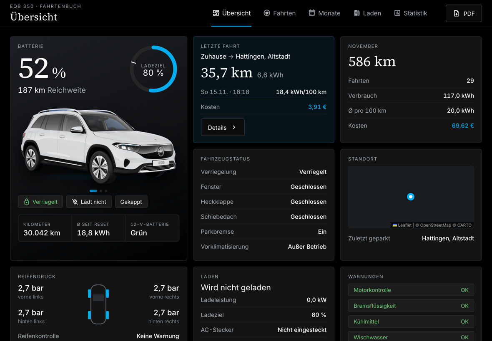
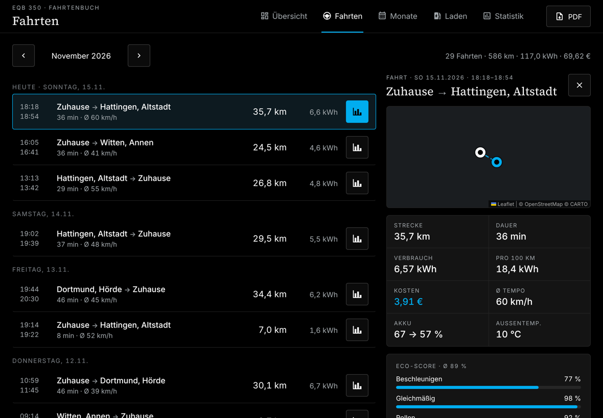
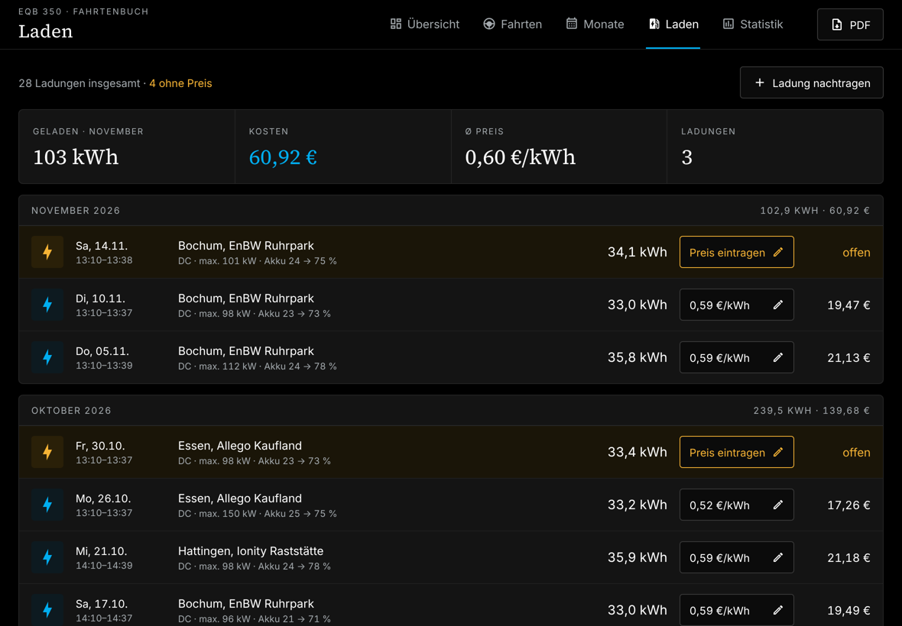
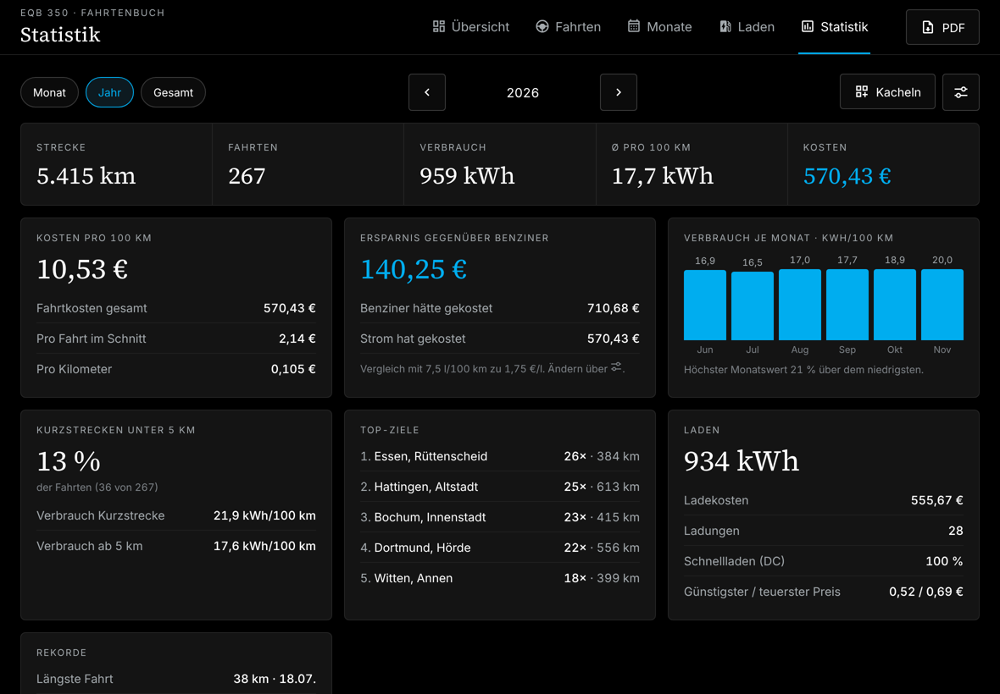

# EQB Fahrtenbuch für Home Assistant

Ein automatisches Fahrtenbuch für den Mercedes EQB 350. Es nutzt die Werte der **MercedesMe2020**-Integration und zeichnet jede Fahrt und jede Ladung selbst auf. Ein Abo bei Mercedes ist dafür nicht nötig.



## Was es kann

- **Fahrten:** Start, Ziel, Kilometer, Dauer, Verbrauch, Kosten, Akkustand, Eco-Score und Außentemperatur. Tippt man eine Fahrt an, erscheinen ihre Statistik und eine Karte mit Start- und Zielpunkt.
- **Monate:** Jeder Monat mit Anzahl der Fahrten, Kilometern, Verbrauch und Kosten.
- **Laden:** Jede Ladung mit kWh, AC/DC und Ort. Den Preis pro kWh oder den Gesamtbetrag trägt man selbst ein.
- **Statistik:** Kacheln zum Auswählen: Kosten pro 100 km, Ersparnis gegenüber einem Benziner, Verbrauch je Monat, Verbrauch nach Temperatur, Kurzstrecken, Top-Ziele, Wochentage, Laden, Eco-Score, CO₂ und Rekorde.
- **PDF:** Oben rechts. Zeitraum und Inhalt sind frei wählbar.
- Läuft am iPad (quer) und am iPhone, mit eigenem Eintrag „Fahrtenbuch“ in der Seitenleiste.

| Fahrten | Laden | Statistik |
|---|---|---|
|  |  |  |

## So funktioniert die Erkennung

| Was | Woher |
|---|---|
| Fahrt beginnt | Zündung wechselt auf „Ein“ oder „Start“ |
| Fahrt endet | Zündung „Aus“ oder „Verriegelt“. Rund 2,5 Minuten später werden Position und Verbrauch übernommen, weil das Auto diese Werte etwas später schickt |
| Verbrauch | „Electric consumption start“ × „Distance start“, also so, wie das Auto selbst rechnet. Fehlen die Werte, nimmt das Fahrtenbuch die Akkudifferenz × Akkugröße |
| Ladung | „Ladevorgang aktiv“ an/aus. kWh aus dem Akkustand (bzw. der gemessenen Ladeleistung). AC/DC über die Ladestecker |
| Ortsnamen | Deine Home-Assistant-Zonen (z. B. „Zuhause“), sonst OpenStreetMap |
| Kosten einer Fahrt | Verbrauch × Ø-Preis aller Ladungen, für die ein Preis eingetragen ist |

Fahrten werden erst **ab der Installation** aufgezeichnet. Ältere Fahrten kann das Fahrtenbuch nicht nachträglich aus dem Auto holen.

---

## Installation (Schritt für Schritt)

### Voraussetzungen
- Home Assistant 2024.11 oder neuer
- **HACS** ist installiert
- Die Integration **MercedesMe2020** ist eingerichtet und zeigt Werte an. Wichtig: Der **Datenmodus „push“** muss aktiv sein, wie im Diagnose-Bereich zu sehen.

### Schritt 1 – Repository in HACS hinzufügen
1. In der Seitenleiste **HACS** öffnen.
2. Oben rechts auf **⋮** und dann **Benutzerdefinierte Repositories** tippen.
3. Bei **Repository** diesen Link eintragen:
   ```
   https://github.com/Bitax/eqb-fahrtenbuch
   ```
4. Bei **Typ** die Option **Integration** wählen und auf **Hinzufügen** tippen.

### Schritt 2 – Herunterladen
1. In HACS nach **EQB Fahrtenbuch** suchen und öffnen.
2. Unten rechts auf **Herunterladen** und dann noch einmal auf **Herunterladen** tippen.

### Schritt 3 – Home Assistant neu starten
**Einstellungen → System → oben rechts ⋮ → Neu starten → Home Assistant neu starten.** HACS zeigt dafür meist auch einen Hinweis unter Einstellungen an.

### Schritt 4 – Fahrtenbuch hinzufügen
1. **Einstellungen → Geräte & Dienste → Integration hinzufügen** und nach **EQB Fahrtenbuch** suchen.
2. Fahrzeug auswählen. Die Akkugröße ist mit 66,5 kWh nutzbar voreingestellt, das passt zum EQB 350 4MATIC. Weicht sie laut Datenblatt ab, trag den richtigen Wert ein. Er wird nur gebraucht, wenn der Verbrauch aus dem Akkustand berechnet werden muss.
3. Der **Standardpreis** gilt nur, bis die erste Ladung einen eingetragenen Preis hat.
4. In der Seitenleiste erscheint jetzt **Fahrtenbuch**. Falls nicht, die App einmal neu laden.

Akkugröße und Standardpreis lassen sich später unter **Geräte & Dienste → EQB Fahrtenbuch → Konfigurieren** ändern.

### Updates
Neue Versionen zeigt HACS automatisch als Update an, sie erscheinen auch unter **Einstellungen**. Auf **Aktualisieren** tippen und Home Assistant neu starten. Die aufgezeichneten Fahrten bleiben erhalten, denn sie liegen getrennt unter `config/.storage/eqb_fahrtenbuch.*`.

### Ohne HACS
Den Ordner `custom_components/eqb_fahrtenbuch` aus diesem Repo nach `config/custom_components/` kopieren, z. B. mit der App **Samba share** oder **Studio Code Server**. Danach Home Assistant neu starten und weiter mit Schritt 4.

---

## Tipps

- **Preis vergessen?** Ladungen ohne Preis sind orange markiert. Bis der Preis eingetragen ist, rechnet die Statistik mit dem Durchschnittspreis.
- **kWh stimmen nicht mit der Abrechnung überein?** Die automatischen kWh sind die Energie, die im Akku angekommen ist. Die Säule berechnet meist etwas mehr, weil beim Laden Verluste entstehen. Tipp einfach auf den Preis der Ladung und trag die kWh oder den Gesamtbetrag laut Abrechnung ein.
- **Ladung verpasst?** Unter **Laden → Ladung nachtragen** kannst du sie von Hand ergänzen.
- **Benziner-Vergleich:** In der Statistik über den Regler-Knopf oben rechts (Verbrauch und Benzinpreis).
- Fahrten unter 200 m werden ignoriert, z. B. wenn nur die Zündung an war.

## Fehlersuche
- **„Kein Fahrzeug gefunden“:** MercedesMe2020 ist noch nicht eingerichtet oder hat noch keine Werte geliefert. Kurz warten, dann erneut versuchen.
- **Fahrten fehlen:** In MercedesMe2020 prüfen, ob der Datenmodus „push“ ist und sich „Ignition State“ beim Fahren ändert.
- **Protokoll:** In `configuration.yaml` Folgendes ergänzen, dann stehen die Details unter **Einstellungen → System → Protokolle**:
  ```yaml
  logger:
    logs:
      custom_components.eqb_fahrtenbuch: debug
  ```

## Technik
- Speicherung: Home-Assistant-Speicher (`.storage`), keine externe Datenbank
- Oberfläche: eigenes Panel ohne Build-Schritt, Karten mit Leaflet und OpenStreetMap/CARTO
- PDF: fpdf2. Home Assistant installiert die Bibliothek beim ersten Start automatisch
- Tests: `pytest tests` (mit `pytest-homeassistant-custom-component`)

Kartendaten © OpenStreetMap-Mitwirkende, © CARTO. Dieses Projekt steht in keiner Verbindung zur Mercedes-Benz Group AG.
